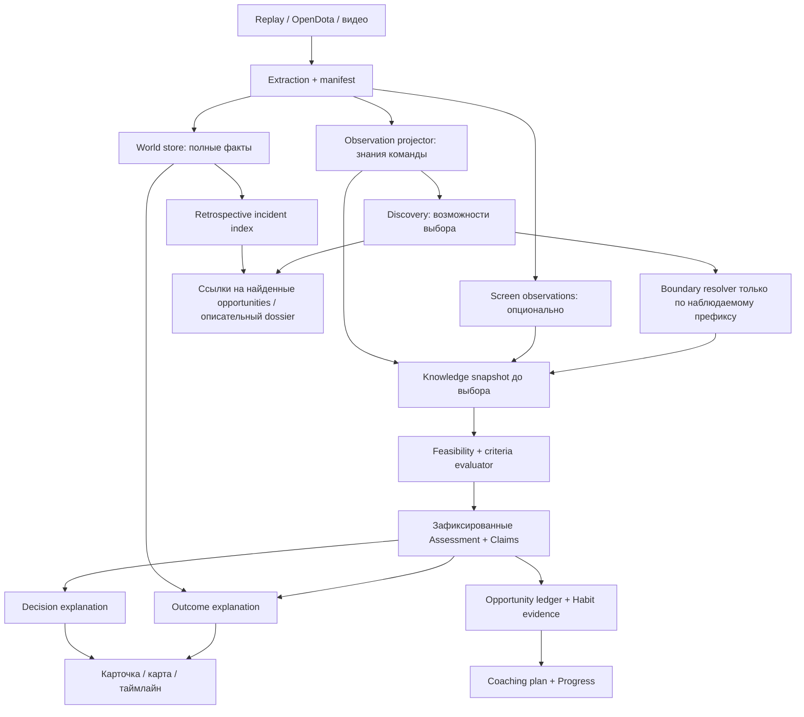

# Целевая архитектура

## 1. Модульный монолит с проверяемыми границами

Сохраняем Go-экстрактор и Python orchestration. На первом этапе нет оснований вводить распределённые сервисы, online inference, vector database или новый frontend framework. Важнее физически ограничить вход оценщика и сделать каждый вывод воспроизводимым.

У ветки `World → Outcome` нет обратного ребра к оценке. Incident index имеет право найти смерть для просмотра и сослаться на уже независимо найденные opportunity_id. Он не выбирает и не меняет anchor/cutoff/окно оценщика: это тоже канал утечки будущего. Если независимо найденной возможности нет, incident даёт только описательный dossier. Тип инцидента, последствия, severity и summary не входят в DecisionInput. Итог отчёта может включать ретроспективные эпизоды, однако метрики охвата и привычек считаются по независимому реестру возможностей, а не по выбранному top-N.

## 2. Четыре вида знания

| Слой | Что содержит | Чего не означает |
|---|---|---|
| WorldState | Извлечённые факты полного replay; тоже могут быть неизвестными/ошибочными | Не знания игрока и не абсолютная истина без проверки извлечения |
| TeamKnowledge | Наблюдения и публичные сообщения, доступные команде к cutoff, история last-seen | Не доказательство того, что игрок заметил информацию |
| ScreenObservation | Подтверждённое содержимое записанного экрана/камеры с качеством синхронизации | Не внимание, намерение или понимание человека |
| IntentHypothesis | Возможные цели, ограничения и пояснения пользователя | Не факт, автоматически полученный из траектории или смерти |

Наблюдаемость задаётся **для каждого факта**, а не общим `enemy.visible`: видимый герой не обязательно делает доступными все его ресурсы, предметы и кулдауны. История покупки после cutoff не доказывает наличие предмета до cutoff. Окончательная роль игрока по всему матчу также не должна незаметно попадать в оценку более раннего решения как достоверный факт.

Last-seen содержит последнее действительно наблюдавшееся значение и время. Он не подменяется текущими world coordinates. Допустимая область возможных положений, если появится, будет отдельной модельной оценкой с ограничениями; точка на карте её не заменяет.

## 3. Границы модулей и API

Предлагаемые пути обозначают будущие модули, а не уже созданный код.

| Будущий модуль | Вход → выход | Ограничение |
|---|---|---|
| `replay_tool` | dem → raw events/state + ExtractionManifest | Только извлечение; никакой оценки игры |
| `ingest/contracts.py`, `ingest/validate.py` | RawArtifact → ValidatedArtifact/Failure | Проверка identity, timebase, схемы, качества, partial/truncated |
| `facts/store.py` | ValidatedArtifact → immutable Fact/Event stream | Evidence locator, поколения сущностей, версии, quality flags |
| `knowledge/projector.py` | Fact prefix + perspective policy → ObservationHistory | Полевая allowlist; unsupported observability остаётся unknown |
| `decisions/discovery.py` | Наблюдаемый trigger stream → Opportunity | Никаких фильтров «только погибшие» |
| `decisions/boundary.py` | Trigger + допустимая история → DecisionBoundary | Не вычисляет выбор как death−N |
| `decisions/input.py` | Boundary + Knowledge → DecisionInput | Сериализованная allowlist; ни ссылок на mutable World, ни Match DTO |
| `decisions/feasibility.py` | Input + MechanicsRegistry → ActionSet | Отделяет техническую выполнимость от разумности |
| `decisions/evaluate.py` | Input + ActionSet + Criterion → Assessment | Чистая функция; без сети, файлового поиска, LLM и outcome |
| `claims/validate.py` | Assessment + evidence/criterion registry → ClaimSet | Ссылки, cutoff, applicability, согласованность вердикта |
| `explain/decision.py` | Разрешённые Claims → Explanation | Только формулировка доказанного; fallback без LLM |
| `explain/outcome.py` | Frozen Assessment + World window → OutcomeAnnotation | Отдельная генерация; не меняет оценку или её причины |
| `coaching/opportunities.py`, `habits.py`, `progress.py` | Полный ledger → план и наблюдение изменения | Сопоставимые условия, знаменатели и версии |
| `recommendations/`, `builds/`, `wards/` | Общие evidence/knowledge + специализированные источники | Не обходят границу наблюдаемости |
| `report.py` / будущие view models | AnalysisArtifact → HTML | Отчёт читает готовую аналитику, не пересчитывает вердикт |

`DecisionInput` передаётся как отдельный сериализуемый DTO. Даже frozen dataclass недостаточно, если внутри остаётся изменяемый словарь полного матча. Импорт и вызов WorldStore из evaluator запрещены архитектурной проверкой. Простая функция с аргументом Match и договорённостью «не читай это поле» не считается разделением.

## 4. Извлечение и время

Событийный журнал — источник истины о порядке извлечённых изменений. Срезы — материализованные представления для UI и грубого поиска. Механические оценки используют точные события и интервалы неопределённости, а не интерполяцию секундных срезов.

Хранить raw replay tick, порядковый номер внутри tick, проверенное отображение в game time, паузы, pregame и время получения артефакта. Не предполагать, что `tick/30` универсально совпадает с игровыми часами. Снимок должен собираться на определённой границе обновления; поле помнит свой возраст. Не смешивать первое обновление одного героя с предыдущим состоянием остальных без отметки.

`available_at` означает момент, когда факт стал доступен соответствующей перспективе в игре. `ingested_at` означает время загрузки после матча. Их нельзя смешивать. Итоговый агрегат интервала [start,end] становится доступен не раньше end, даже если провайдер положил его рядом с start.

Неизвестный clock mapping, незавершённый replay, дырки в событиях или неопределённый порядок внутри tick могут разрешать описательный отчёт, но запрещают зависимую механическую оценку. У каждого класса собственные требования к точности; общего флага `parsed=True` недостаточно.

## 5. Вердикт и доказательство

Поддерживаем пять результатов: хорошее решение в рамках критерия; несколько разумных вариантов; вероятная ошибка; подтверждённая ошибка **в пределах проверенного критерия**; недостаточно данных. `not_applicable` — статус применимости, а не шестой вердикт.

Критерий содержит область применения, необходимые факты, проверенные механики патча, возможные цели, исключения, действие/альтернативы, процедуру оценки и валидацию. Сработавший критерий не доказывает универсальную оптимальность. Например, техническая доступность защитного предмета сама по себе не доказывает, что его стоило применять.

Каждая альтернатива имеет feasibility=`feasible|infeasible|unknown`, ссылки на предпосылки, стоимость и ограничения. Действия «уйти» и «позвать союзника» нельзя объявлять выполнимыми по одному расстоянию. Оценка возможности подключения требует позиции, пути/препятствий, ресурсов, транспорта и текущих обязательств союзника; если они неизвестны, нет точного ETA или обещания спасения.

Вероятная ошибка — отдельная экспертно проверенная категория аргумента, а не способ обойти отсутствующее обязательное поле словом «вероятно». Существенная неопределённость должна менять вердикт или приводить к отказу.

## 6. LLM и защита смысла

LLM получает ClaimSet с разрешёнными аргументами, альтернативами, ограничениями и формулировками упражнения. Она не выбирает verdict, не придумывает evidence_id, проценты уверенности, причинный выигрыш или новые рекомендации.

Первый релиз: критические заголовки, числа и основания выводятся шаблонами. LLM может сокращать и связывать текст. Проверка наличия citation IDs не доказывает, что текст следует из источника: фраза «вард жил 20 секунд, поэтому был бесполезен» остаётся недопустимой даже со ссылкой. Поэтому свободные причинные claims не проходят автоматически; нужен проверенный шаблон/criterion либо экспертная проверка.

Не прошедший проверку ответ заменяется детерминированной карточкой, а не повторными попытками получить более уверенный текст. Outcome explanation формируется отдельно и подписывается «что произошло после выбора». Объяснение решения не меняется при изменении будущего. Feedback или текст внешнего источника — данные, не команды для модели.

LLM-cache должен учитывать provider/model/config, prompt version, language, claim hash и policy version. Кеш по одним messages при смене модели недостаточен для воспроизводимой проверки.

## 7. Персональный coaching и стиль

Разделить старый Leak на:

- `DescriptiveSignal`: измерение с популяцией сравнения, патчем, ролью, источником и пропусками.
- `HabitEvidence`: повторение проверенного выбора в определённых условиях, примеры и контрпримеры.
- `CoachingPlan`: одно упражнение, условие применения, способ измерения и дата пересмотра.

Регистрировать все обнаруженные opportunities: eligible, ineligible, unknown; среди eligible — assessed и abstained. Частота ошибок = число эпизодов с данным проверенным паттерном / число оценённых сопоставимых возможностей. Рядом всегда показывать coverage = assessed / eligible, число неизвестных eligibility и ограничения discovery. Ноль оценённых ситуаций даёт null, не нулевую ошибочность.

Стиль — измеряемые распределения выбора при сопоставимых возможностях: принятие риска, перемещения, ресурсы, участие, предметы. Смерти, damage и GPM сами по себе не устанавливают стиль. Агрессивность не штрафуется; оцениваются ошибки внутри выбранного подхода. История одного матча не превращается в устойчивый ярлык.

Progress сравнивает неперекрывающиеся периоды и совместимые контексты: player, habit/criterion version, role estimate, hero scope, patch compatibility, соперники и качество данных. Хранит IDs матчей/возможностей и знаменатели. Повторный анализ тех же матчей обновляет результат того же периода, а не доказывает прогресс.

Статусы: `no_baseline`, `insufficient_opportunities`, `incomparable`, `stable`, `improving`, `worsening`, `sustained_target_met`. Последний означает выполнение конкретной цели в заданном периоде, не пожизненное «исправлен». Числовой сдвиг требует заранее выбранного практически значимого порога и оценки неопределённости. Смена детектора/патча требует rebaseline либо проверенного пересчёта обеих выборок.

Ответы «цель была другая», «не согласен», «полезно» сохраняются с версиями и ссылкой на карточку. Их нельзя автоматически превращать в gold labels или запускать обучение на собственных ответах. Новая цель создаёт отдельный scenario revision; исходный разбор остаётся доступным.

## 8. Учебные матчи, билды, варды

**Матчи сильных игроков.** Отдельный каталог существующих матчей: source, fetched/verified time, match_id, patch, герой, качество роли, проверенный статус pro/high-MMR, replay availability. Сначала hard filters доступности и применимости, затем сходство задач/контекстов и измеримых характеристик стиля. Возвращать эпизоды, конкретное задание для просмотра и различия, ограничивающие перенос. Correlation/retrieval не доказывает превосходство действия. Каталог не подключён → `source_not_connected`; replay истёк → `replay_unavailable`; LLM не создаёт IDs и URL.

**Контекстные билды.** BuildPlan привязан к knowledge snapshot: видимые угрозы, задачи, экономика, роль, стадия. У вариантов есть решаемая проблема, отказ от других ресурсов, техническая доступность покупки и условия пересмотра. Механики версионируются по патчу. Популярность, статистическая связь с победой и рекомендация — разные поля. Будущие скрытые предметы противника не объясняют, что игрок «должен был купить». Нет проверенной модели — нет численной потери win probability или контрфактического золота.

**Варды.** Разделить оценку размещения по знаниям на момент установки и фактически полученную позже информацию. Длительность жизни, покрытие области и информационная польза — разные показатели. Учитывать неизвестную/цензурированную дату удаления, повторное использование entity index, pregame wards, источник атрибуции информации: враг мог быть виден и благодаря другому источнику. При невозможности атрибуции нельзя приписывать всю информацию одному варду. Без безопасного маршрута и ресурсов альтернатива установки имеет feasibility=unknown. Геометрия в UI по умолчанию приблизительная до проверки карты/рельефа/деревьев/патча.

## 9. Представление пользователю

Существующий HTML остаётся доставляемым локальным артефактом. На первом экране — несколько приоритетных оценённых решений, положительные примеры и покрытие; пропущенные по данным эпизоды доступны отдельно. Приоритет — полезность упражнения, повторяемость и сила доказательств, не число смертей.

Карточка показывает: выбор и время/интервал → вердикт с областью действия → факты и доступность знания → выполнимые альтернативы → неизвестное → упражнение. Источники раскрываются до raw event/кадра/клипа с точностью времени. Отсутствие клипа не убирает доказательства; отсутствие доказательств не маскируется клипом.

На карте два явно переключаемых режима: «знания команды» и «полный replay». В первом нельзя отрисовывать скрытые текущие координаты. Last-seen подписан временем; неопределённость не изображается точным маркером. Переключение на полный replay не пересчитывает verdict.

Обязательные состояния: loading, source_unavailable, parse_failed, partial_data, unsupported_patch, no_history, no_eligible_opportunities, insufficient_evidence, no_issue_within_coverage, recommendations_unavailable. Это разные состояния, а не один пустой список.

Для локального HTML feedback первоначально можно экспортировать в JSON; серверное сохранение не обещать до реализации. Demodata явно помечены и не попадают в историю игрока, метрики качества или каталог рекомендаций.

## 10. Хранение и эксплуатация

Сначала content-addressed JSON/JSONL плюс небольшой локальный индекс SQLite при необходимости поиска истории. Сырые артефакты неизменяемы; analysis runs адресуются версиями и входными хешами. Не вводить отдельную БД ради каждой стадии.

Parse cache key: replay content hash + extractor version + schema + options; analysis key дополнительно включает perspective, decision boundary, knowledge policy, mechanics и criterion versions. Запись атомарная после валидации. Повреждённый cache выдаёт отдельную причину, не пустой успешный отчёт.

AnalysisRun содержит статусы стадий, качество capabilities, structured abstention reasons и evidence counts. Нет внешней зависимости для детерминированного evaluator: отказ LLM/видео не должен ломать оценку и фактическую карточку. Несовместимый новый патч выключает зависимый критерий, сохраняя описательные данные.

Пределы памяти/размера replay, timeout парсера и потоковая обработка нужны на границе ingest; не загружать все raw events во все карточки. Observation history строится одним упорядоченным проходом с индексом, вместо повторного сканирования всего replay для каждого эпизода.

## 11. Отвергнутые архитектурные предположения

| Предложение | Почему не принимается |
|---|---|
| Достаточно скрыть radiant_win | Будущее и hidden world доступны через другие поля |
| Дать всё LLM и попросить не использовать | Нет проверяемой информационной границы |
| Любая смерть содержит плохой выбор | Исход не идентифицирует качество решения |
| Фиксированный t−5 — момент выбора | Не учитывает начало обязательства, порядок событий и отсутствие выбора |
| Сравнить с победителями и выбрать их действие | Selection/confounding; не causal counterfactual |
| Сразу обучить policy/value model на ответах тренера | Усилит ошибки собственной разметки без независимого эталона |
| Полностью переписать приложение | Не устраняет ограничения фактов, тратит существующую полезную инфраструктуру |
| Каждый анализ должен выдать ошибку | Стимулирует ложные обвинения и маскирует неизвестность |

Цена выбранной архитектуры: меньший исходный охват, необходимость реальных проверочных данных и экспертной работы. Выигрыш: можно установить, почему система считает решение плохим, где она не знает и что именно нужно улучшить для расширения охвата.
